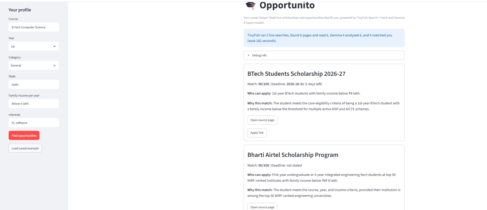
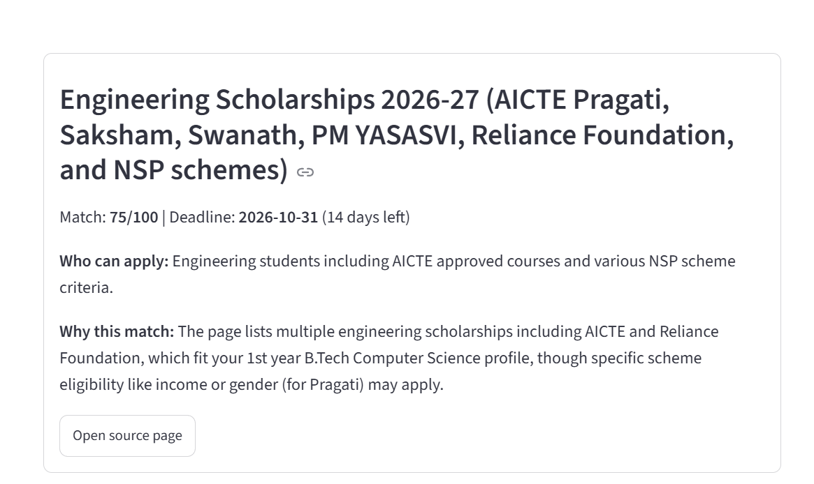

# Opportunito 🎓

**Your career helper.** Opportunito finds live scholarships and opportunities for Indian students, checks whether the student is actually eligible, and ranks them by fit.

🎥 **Demo video:(https://drive.google.com/file/d/1TBUCMvzEHojcK6v8D-4fRGgG9-tM_Wc4/view?usp=sharing)
📝 **Project post:(https://lnkd.in/p/gX4QtJVZ)

---

## The problem

Scholarships, internships and fellowships are scattered across hundreds of websites. Eligibility rules and deadlines are buried in long pages, and many students never find out about opportunities they qualify for. Static lists go out of date quickly.

## The solution

Opportunito is an AI agent that works on the **live web**:

1. The student enters a short profile: course, year, category, state, family income and interests.
2. The app searches the live web for current opportunities.
3. It opens and reads each page.
4. It pulls out the title, deadline, eligibility rules and apply link.
5. It scores how well each opportunity fits the student and explains why.
6. It hides expired items and shows a ranked list.

## How TinyFish is used

TinyFish is the core of the product. Without it, the app would have no live data.

| TinyFish tool | What it does in Opportunito |
|---|---|
| **Search API** | Finds fresh opportunity pages from the live web based on the student's profile. Results are not from a fixed database. |
| **Fetch API** | Opens each result page (including JavaScript-heavy pages and PDFs) and returns clean markdown that the AI can read. |

In the code, see `run_pipeline()` in `app.py`:
- `tf.search.query(...)` runs the searches.
- `tf.fetch.get_contents(...)` reads the pages.

## Tech stack

- Python
- Streamlit (web interface)
- TinyFish Search and Fetch APIs
- Google Gemini (extraction and matching)
- Pydantic (structured output)

## How it works (flow)

```text
Student profile
      |
      v
TinyFish Search  -->  list of live pages
      |
      v
TinyFish Fetch   -->  clean page text
      |
      v
Gemini           -->  title, deadline, eligibility, match score + reason
      |
      v
Expired items removed, results ranked, shown in the app
```

## Run it yourself

**1. Clone the repo**
```
git clone https://github.com/magan69/opportunito.git
cd opportunito
```

**2. Create and activate a virtual environment**

Windows (PowerShell):
```
python -m venv venv
.\venv\Scripts\activate
```
Mac/Linux:
```
python -m venv venv
source venv/bin/activate
```

**3. Install the dependencies**
```
pip install -r requirements.txt
```

**4. Add your API keys**

Create a file named `.env` in the project folder:
```
TINYFISH_API_KEY=your_tinyfish_key
LLM_API_KEY=your_gemini_key
```
- Get a TinyFish key at agent.tinyfish.ai/api-keys
- Get a Gemini key at aistudio.google.com

**5. Start the app**
```
python -m streamlit run app.py
```
The app opens in your browser at `http://localhost:8501`.

## How to use it

1. Fill in your profile in the left sidebar.
2. Click **Find opportunities**.
3. Wait 30-60 seconds while the app searches and reads pages.
4. Review the ranked cards. Each shows the match score, deadline, eligibility, the reason for the match, and links to the source page.

## Screenshots




## Design choices

- **No guessing:** if a page does not state a deadline, the app shows "not stated". It never makes one up.
- **Eligibility-aware:** the match score is lowered when the student's profile clearly does not meet the rules.
- **Skips non-opportunities:** pages that are only articles or lists are filtered out.
- **Rate-limit friendly:** the app reads a limited number of pages per search and pauses between AI calls.

## Limitations

- Results depend on what the search returns and which sites allow automated reading. Some pages fail to load and are skipped.
- Gemini can make mistakes. Students should always confirm details on the official page before applying.
- Deadlines are only shown when the page states them.

## Future work

- **TinyFish Monitors** to alert students when a deadline or page changes.
- Saved student profiles.
- Email or WhatsApp reminders before deadlines.
- Support for regional languages.

## Author

Magan Shandilya
laxmeswaram krishnam
shaurya bhatnagar
shubham jaiswal
University School of Information, Communication and Technology(GGSIPU)
https://github.com/magan69

Built for AZINHACK '26.

